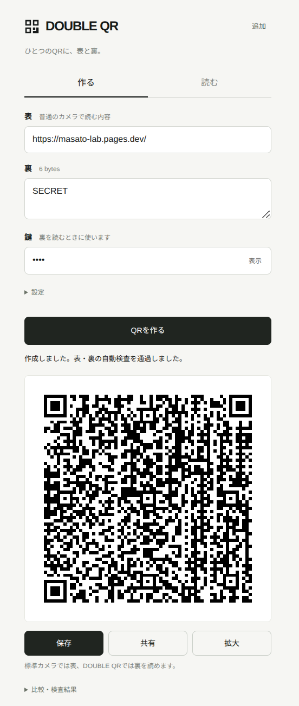

# DOUBLE QR v0.8 PWA

ひとつのQRに、表と裏のメッセージ。

## ▶ [アプリを開く](https://masato-nasu.github.io/DOUBLE-QR/)

インストール不要。リンクを開くとブラウザで使えます。ホーム画面への追加にも対応しています。

「作る」「読む」の2画面。ビルド済みの静的ファイルだけで動きます。処理用Pythonサーバー、データベース、外部CDNは不要です。鍵・本文・画像は端末内で処理します。最初の取得とアプリ更新には通信が必要です。

## 設計で優先すること

**一見すると普通の白黒QRコードであり、一般的なカメラでは表の情報が通常通り読めること。**
1枚の静止画という条件を維持し、裏の容量拡張はこの条件を満たした範囲でのみ検討します。動画化・特殊な色や模様の追加はしません。

5,000文字は研究目標ですが、現状の白黒二値QRで任意の5,000文字を裏に詰め込むことはできません。理論上の容量と実際のスマートフォン読み取り成功率も区別します。外見上気づきにくいことは、技術的な不可検出性の保証とは別です。

詳細：[設計原則と容量の物理的限界](./DESIGN-PRINCIPLES.md)

[容量実験と実機検証条件の記録](./CAPACITY-RESEARCH.md)

## スクリーンショット

**現在のv0.8をブラウザで実際に動かして撮影したスクリーンショット**です。表は `https://masato-lab.pages.dev/`、裏は `合歓の木の 在りて終日 三途にて`、QRサイズは「自動」です。画像はGitHub Actionsの「Update README screenshot」から再生成できます。

## 裏の容量と自動選択（v0.5）

裏の文字数は **UTF-8のバイト数** で判定します。新方式は1バイトを1つのQR誤り訂正コード語にまとめて埋め込み、ブロックごとに負担を分散します。

- 従来の手動Version 12モードの「埋め込み強度：自動」は5重 → 3重 → 1重の順に試します。**v0.8全体の初期設定はQRサイズ自動**であり、別の可変サイズ・余白実験方式です。
- 1重：最大123バイト、3重：最大35バイト、5重：最大17バイト（現在のQR仕様における誤り訂正予算から計算した安全な形式上限）。
- 実際のスマートフォン撮影や印刷からの読み取りは、画質・距離・光の条件によるため保証はできません。
- v0.3 / v0.4の従来方式のQRも引き続き「読む」で復元可能です。既存のQRを書き換える必要はありません。

## 圧縮と大きいQRの研究モード（v0.6）

Version 12/Hと圧縮なしの手動モードはそのまま残しています。v0.8の初期設定は、上記の自動可変サイズと自動圧縮です。

「設定」では、固定QRサイズや圧縮オフにも切り替えられます。

- **文章の圧縮 → 圧縮を試す**：端末内のDEFLATEで原文を圧縮します。圧縮後の情報が小さくなる場合だけ圧縮形式にします。復元時は自動で展開します。以前作ったQRとの読み取り互換性も維持します。
- **QRサイズ → 大きい Version 20**：通常規格の白黒97×97マスのQRを使います。現行の65×65マスより裏の容量を増やせますが、マスが細かくなるため**実際のPC画面→スマートフォン撮影ではまだ未検証**です。
- **両方を組み合わせることも可能**です。ただし、どちらも保存前にZXingとjsQRの表読み取りおよび専用リーダーの裏復元に合格する必要があります。

5,000文字の圧縮成功例は、「秘密」を2,500回繰り返した文章です（日本語5,000文字／UTF-8 15,000バイト）。**任意の5,000文字を格納できるという意味ではありません。** ランダムに近い文章など、圧縮されにくい内容は容量を超えます。外部URLへ本文を預ける方式ではなく、裏データは1枚のQR画像の中にあります。

Version 20の使用時は、QRを全画面で表示し、スマートフォンの標準カメラで表が読めるかと、DOUBLE QR専用の「読む」で裏まで読めるかを実機で確認してください。合格するまでは従来版を基本とします。

## 自動可変QRサイズと初期入力（v0.8）

生成画面を開くと、表には `https://masato-lab.pages.dev/`、裏には `合歓の木の 在りて終日 三途にて` が最初から入力されています（いずれも編集できます）。

QRサイズの初期設定は **「自動（裏の長さに合わせる）」**、文章の圧縮は **「自動圧縮」** です。

1. 元の文章が圧縮で小さくなる場合、暗号化前にDEFLATEで圧縮します。
2. 裏データの保存バイト数と表のURL長から、Version 12〜36の中で格納できる最小バージョンを選んで試します。
3. 候補が普通のQRリーダー2種類（ZXing・jsQR）で表を読み、専用の裏復元も全文一致した場合のみQRを表示・保存します。候補が不合格なら大きいバージョンに進みます。
4. 「読む」ではQRの冗長なバージョン情報を利用し、サイズに合わせて裏を復元します。以前の固定Version 36のQRも読めます。

**重要**：自動サイズの生成には余白データ方式を使うため、終端後のパディング値はQR規格の指定値と異なります。見た目は白黒QRですが、全機種の標準リーダーに対する互換性は保証できません。スマートフォン実機で表と裏の全文復元が確認できたのはVersion 36の一例であり、他サイズはこれから実機確認が必要です。

以前の「標準・Version 12」と「大きい・Version 20」、固定Version 36も手動で選択できます。既存画像の読み取り互換性は維持します。

## 余白データを利用する大容量実験（v0.7）

**最重要条件：見た目が普通の白黒QRであること、スマートフォンの普通のカメラで表のURLが読めること。** 動画や追加マーカー、外部サーバーは使用しません。

「設定」→「QRサイズ」→ **大容量・Version 36（余白実験）** を選ぶと、標準QRのデータ終端以降にある余白のバイトを利用して裏の文章を記録できます。Version 12とVersion 20は手動選択で残しています。新しい初期設定は容量に応じた自動サイズです。

- **Version 36 / 誤り訂正M / 161×161マス**。表のURL長により裏の実用保存容量が変わります。
- 表が `https://masato-lab.pages.dev/` の場合、保存データの計算上限は **1,868バイト**。裏のパケットには識別子・長さ・認証タグの合計14バイトを別途使います。
- 圧縮を有効にすれば、元の文章がこの数字より長くても圧縮後のデータが1,868バイト以下なら候補になります。原文3,980バイト→圧縮後1,679バイトというケースは計算上収まります。
- 8種類の標準マスクを順に試し、ZXingとjsQRで表を、専用リーダーで裏の本文全体を読めた候補だけ表示・保存します。生成中は時間がかかることがあります。
- 「読む」は従来版のほか、このVersion 36方式も画像から復元します。カメラでは複数フレームからの復元も試みます。
- **注意**：QRの外観は通常の白黒ですが、規格が定める終端後のパディングの値を別の値に置き換えるため、厳密な規格準拠ではありません。標準リーダーの全機種・印刷物での互換性は保証できません。
- Version 36では普通のスマートフォンカメラで表のURLを開き、専用リーダーで圧縮前の3,980バイトが最後まで表示されたという実機成功報告があります。**他のQRサイズ・機種・表示条件まで保証するものではありません。**

新モードを試すときは、PCに大きく表示して普通のカメラで表のURLが開くことを確認後、携帯電話のDOUBLE QR「読む」から同じ鍵で裏を復元してください。

[容量実験の背景](./docs/PADDING-FEASIBILITY.md)

## 更新ボタンが押せない場合

古いPWAのキャッシュが残って「Version 36」が表示されない場合は、別ページの **[更新専用ページ](https://masato-nasu.github.io/DOUBLE-QR/refresh.html)** を開いて、「最新版を開く」を押してください。DOUBLE QR専用のService Worker登録と、そのオフラインキャッシュだけを解除して、ネットワークから読み込み直します。

**現在入力している裏の文章・鍵は画面を閉じると消えます。先にコピーしてから更新してください。** 他のサイトのキャッシュ、スマートフォンの設定や画像ファイルには触れません。更新には通信が必要です。

## 画像の共有と保存

- **共有**：ブラウザが画像ファイルのOS共有機能に対応している場合は共有画面を開きます。
- 対応していない場合は、勝手に画像をダウンロードせず、共有方法を案内します。クリップボード画像に対応するブラウザでは「画像をコピー」からLINEやメールなどに貼り付けられます。
- **保存**：PNG画像を端末に保存します。共有ボタンと独立した操作です。
- QRには裏のデータが含まれるため、表のURLだけを代わりに共有することはしません。

## スマートフォンで使う

HTTPSの公開先をSafari / Chromeで開きます。「オフラインで使えます」と表示されてからホーム画面に追加してください。iPhoneは共有メニュー、Androidはブラウザメニューの「アプリをインストール」または「ホーム画面に追加」を使います。表示名称は端末・ブラウザで異なります。

1. 表のURL、裏メッセージ、鍵を入力し「QRを作る」。
2. 検査を通過した画像を保存。普通のQRと二重QRは、普通のカメラでは同じ表のURLに進みます。これは正常な動作です。
3. 「読む」で同じ鍵を入力し、カメラまたは画像選択から裏を復元。強度は自動判定します。

鍵・メッセージは自動保存しません。画面を閉じると消えます。手動の実機記録だけをブラウザに保存します。保存したPNGやコピーした裏メッセージは保存先に残ります。

ブラウザがアプリのキャッシュを削除した場合、再度オンラインで開いてください。更新は「詳細・診断」→「ホーム画面に追加」→「更新を確認」。更新を適用すると入力が消えます。

## 技術資料

- https://developer.mozilla.org/en-US/docs/Web/Progressive_web_apps/Guides/Making_PWAs_installable
- https://developer.mozilla.org/en-US/docs/Web/API/Service_Worker_API
- https://github.com/Sec-ant/zxing-wasm
- https://github.com/cozmo/jsQR
- https://developers.cloudflare.com/pages/get-started/direct-upload/
